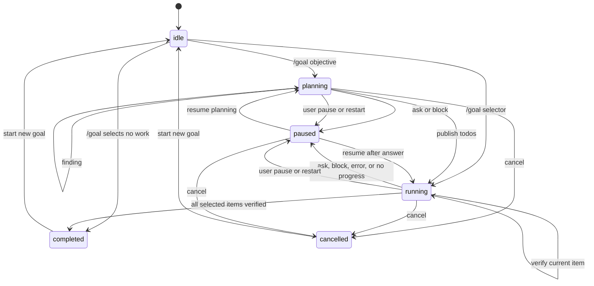

# Goals in Pi 0.80.2

## Problem and command contract

A user wants Pi to work from the real todo list until selected work is verified, or until a decision needs the user's attention. The session branch owns the list, plan, question, and evidence. The fork runs independently of other goal or planning packages.

| Command | Behavior |
| --- | --- |
| `/goal` | Freeze the currently unfinished IDs. |
| `/goal complete todo item #3` | Select an existing item. |
| `/goal complete todo items #2-#5` | Select the inclusive range. Report gaps and skip finished work. |
| `/goal <objective>` | Clarify material uncertainties, then publish a plan with prerequisites and done criteria and start its items. |
| `/goal-status` | Show scope, progress, current item, and outstanding question or blocker. |
| `/goal-pause` | Stop goal execution and retain the current item. |
| `/goal-resume` | Reconcile and continue the original phase and selection. A clarification requires an answer first. |
| `/goal-cancel` | End the run and release its unfinished current item to pending. |
| `/todos` | Display the existing numbered list. |

## State transitions

Idle and terminal states accept a new goal. Free text enters planning. A selector enters running, paused for unresolved dependencies, or completed for finished work. Planning can ask a question or publish the plan atomically and enter running. Running selects the lowest ready ID, verifies the current item, records its evidence, and repeats. It completes when the selection is finished. Planning and running can pause on a question, user request, interrupted run, error, or lack of progress. A paused run remembers its phase. Discussion alone never resumes it. Resume rechecks prerequisites and stable row identities. Cancellation is terminal. Navigation and restart restore active runs paused. Forked sessions do not inherit ownership.



## Integration decisions

The existing todo reducer owns row creation, status transitions and prerequisite validation. The goal controller owns selection, sequencing and user decisions. Each goal transition appends both the resulting rows and the goal to one session entry before publishing the in-memory change. The ordinary todo tool continues to replay older sessions. A stable marker on each selected row prevents a reused numeric ID from satisfying a previous goal.

Pi registers the commands and the agent-facing `goal_step` tool through the package's existing extension entry point. Each dispatched turn receives the objective, phase, current row, latest answer and finding. An item closes when the agent supplies its ID, the check it performed and the observed result. The evidence is the agent's report. The extension checks identity, prerequisites and required fields. [Pi packages](https://docs.pi.dev/latest/packages)

Continuation appears as `Working on todo #3 — <subject>` or `Planning — <objective>`. Dispatch identifiers live in extension-message metadata. Execution instructions are appended as hidden extension messages while the transcript displays the label. This uses the custom-message API available in Pi 0.80.2.

Completion is evaluated when the agent submits `goal_step` with `action: "complete"`. It must identify the current item and supply both the check performed and its observed result. After checking row identity, current status and prerequisites, the plugin saves that evidence, completes the todo and selects the next ready item. The goal completes when the whole selection is finished. Ending a turn alone does not complete an item. The agent-end hook checks interruption and observed progress to decide whether to continue or pause. Verification quality depends on the working agent's checks and evidence.

Before every goal dispatch, the runner reconciles the original selection against the shared todo store. It validates stable row identities and prerequisites, advances past completed rows, and updates the current item. A deleted or replaced row pauses the run. Unresolved prerequisites pause when no selected item is ready. A fully completed selection ends the goal without starting another model turn. Newly added rows join a future goal when selected. Reload and tree navigation rebuild the shared store from the branch history.

Each continuation prompt is refined from the reconciled list and a persisted observation history. A hidden snapshot is appended before dispatch. During a run, the `turn_end` hook appends changed guidance after the entire tool-result batch, using Pi's steering queue so the next model response sees it. Identical guidance is skipped. Earlier messages and system instructions retain their original content, including through pause, resume, completion and restart. Compaction and explicit branch navigation establish a new history boundary.

Refinements include all recorded findings and failed approaches, the latest eight progress observations, completed-item evidence, remaining rows, the current item's criteria and the latest relevant proposed next step. A failure adds instructions to diagnose its cause and revise the approach before retrying. Findings direct the agent to revisit contradicted assumptions. Progress directs it to build on the work already observed and check what remains against the completion criteria. This refinement compiles the recorded evidence into context and priorities for the working model. The working model decides and reports the revised approach.

The append-only model history preserves matching request prefixes for provider caching. The smoke test captures the actual scripted-provider inputs and checks that each successive message list extends the previous one, with the same system prompt. It ignores runtime timestamps that Pi recreates when replaying custom messages and compares the remaining fields exactly. It also checks that a tool failure receives an appended recovery refinement within the same goal run. This verifies request structure. Cache-hit rates and token savings depend on the provider and its cache settings.

The `goal_step` tool accepts these updates during an authorized goal turn. Each successful update checkpoints the history and ends the turn so the next continuation receives the refinement.

| Action | Required fields | Effect |
| --- | --- | --- |
| `progress` | `message` | Record concrete progress. Optional `next` proposes the next step. |
| `finding` | `message` | Retain a discovery alongside previous findings. Optional `next` proposes a response. |
| `failure` | `approach`, `result`, `next` | Record what failed, the observed result and a revised next step. |

Tool results also add progress or failure observations. Automatic entries include an input excerpt of up to 500 characters and text output of up to 2,000 characters. Successful tool output is an observation for the model to assess. The `complete` action still requires its own verification evidence. Duplicate observations add no progress, allowing the existing no-progress check to pause a repeated unsuccessful run. Version-1 snapshots with a single legacy finding continue to load and retain that finding when the new history is first written.

Two design ideas carry over from the reference projects. Persistent execution gives Pi a reason to continue after a turn ends. Returning a concrete question to the user lets the agent incorporate feedback at the point of uncertainty. Both behaviors run inside the fork using Pi's session and messaging APIs. [pi-goal-x](https://github.com/tmonk/pi-goal-x) · [Plannotator](https://github.com/backnotprop/plannotator)

## Implementation goals and review checkpoints

Work through these slices in order. Before moving on, record the command, observed result, and any outstanding failure.

1. **Prove the baseline.** Exercise the fork on Pi 0.80.2 in an isolated profile. Review the package manifest and confirm only this fork registers the tool.
2. **Select real work.** Cover bare, single, range, invalid and completed selections. Review readiness with a prerequisite outside the range and a new item added after start.
3. **Publish and recover.** Commit stable row identities and goal changes alongside the todo snapshot. Review interrupted planning, clear and ID reuse, reload, and fork ownership.
4. **Run and verify.** Require a check and its observed result. Review both the ordinary todo tool and goal tool for completion bypasses. Count tool work or a recorded finding as progress. Pause on promises alone.
5. **Clarify and pause.** Preserve the question and answer, fence queued turns, and block goal work during discussion. Review pause, resume, and cancel in planning and execution.
6. **Exercise the complete journey.** Start #2–#5, verify #2, ask on #3, answer, reload, resume #3, finish through #5 and leave #6 pending. Run upstream regressions and check the installed package was untouched.

## Running the acceptance checks

From the monorepo root, run:

```sh
node_modules/.bin/vitest run packages/rpiv-todo
node_modules/.bin/tsc --noEmit -p tsconfig.base.json
python3 scripts/test-goals/smoke.py
```

The smoke test launches the Pi binary on PATH with an isolated profile, session directory, the fork and an in-process scripted model. It inspects persisted rows after a range run, a clarification, a process restart and a free-text goal. It also checks user pause, interrupted planning, cancellation, a no-progress pause, and the default selection. Human review of the overlay and the quality of a real model's completion evidence remain separate checks.
