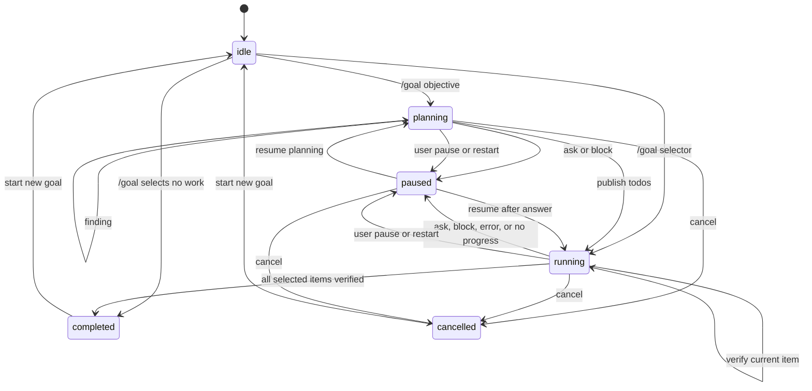

# Goals in Pi 0.80.2

## Problem and command contract

A user wants Pi to work from the real todo list until selected work is verified, or until a decision needs the user's attention. The session branch owns the list, plan, question, and evidence. The fork runs independently of other goal or planning packages.

| Command | Behavior |
| --- | --- |
| `/goal` | Freeze the currently unfinished IDs. |
| `/goal complete todo item #3` | Select an existing item. |
| `/goal complete todo items #2-#5` | Select the inclusive range. Report gaps and skip finished work. |
| `/goal <objective>` | Clarify material uncertainties, then publish a plan with prerequisites and done criteria and start its items. |
| `/goal-status` | Show scope, progress, current item, and outstanding question or blocker. |
| `/goal-pause` | Stop goal execution and retain the current item. |
| `/goal-resume` | Reconcile and continue the original phase and selection. A clarification requires an answer first. |
| `/goal-cancel` | End the run and release its unfinished current item to pending. |
| `/todos` | Display the existing numbered list. |

## State transitions

Idle and terminal states accept a new goal. Free text enters planning. A selector enters running, paused for unresolved dependencies, or completed for finished work. Planning can ask a question or publish the plan atomically and enter running. Running selects the lowest ready ID, verifies the current item, records its evidence, and repeats. It completes when the selection is finished. Planning and running can pause on a question, user request, interrupted run, error, or lack of progress. A paused run remembers its phase. Discussion alone never resumes it. Resume rechecks prerequisites and stable row identities. Cancellation is terminal. Navigation and restart restore active runs paused. Forked sessions do not inherit ownership.



## Integration decisions

The existing todo reducer owns row creation, status transitions and prerequisite validation. The goal controller owns selection, sequencing and user decisions. Each goal transition appends both the resulting rows and the goal to one session entry before publishing the in-memory change. The ordinary todo tool continues to replay older sessions. A stable marker on each selected row prevents a reused numeric ID from satisfying a previous goal.

Pi registers the commands and the agent-facing `goal_step` tool through the package's existing extension entry point. Each dispatched turn receives the objective, phase, current row, latest answer and finding. An item closes when the agent supplies its ID, the check it performed and the observed result. The evidence is the agent's report. The extension checks identity, prerequisites and required fields. [Pi packages](https://docs.pi.dev/latest/packages)

Two design ideas carry over from the reference projects. Persistent execution gives Pi a reason to continue after a turn ends. Returning a concrete question to the user lets the agent incorporate feedback at the point of uncertainty. Both behaviors run inside the fork using Pi's session and messaging APIs. [pi-goal-x](https://github.com/tmonk/pi-goal-x) · [Plannotator](https://github.com/backnotprop/plannotator)

## Implementation goals and review checkpoints

Work through these slices in order. Before moving on, record the command, observed result, and any outstanding failure.

1. **Prove the baseline.** Exercise the fork on Pi 0.80.2 in an isolated profile. Review the package manifest and confirm only this fork registers the tool.
2. **Select real work.** Cover bare, single, range, invalid and completed selections. Review readiness with a prerequisite outside the range and a new item added after start.
3. **Publish and recover.** Commit stable row identities and goal changes alongside the todo snapshot. Review interrupted planning, clear and ID reuse, reload, and fork ownership.
4. **Run and verify.** Require a check and its observed result. Review both the ordinary todo tool and goal tool for completion bypasses. Count tool work or a recorded finding as progress. Pause on promises alone.
5. **Clarify and pause.** Preserve the question and answer, fence queued turns, and block goal work during discussion. Review pause, resume, and cancel in planning and execution.
6. **Exercise the complete journey.** Start #2–#5, verify #2, ask on #3, answer, reload, resume #3, finish through #5 and leave #6 pending. Run upstream regressions and check the installed package was untouched.

## Running the acceptance checks

From the monorepo root, run:

```sh
node_modules/.bin/vitest run packages/rpiv-todo
node_modules/.bin/tsc --noEmit -p tsconfig.base.json
python3 scripts/test-goals/smoke.py
```

The smoke test launches the Pi binary on PATH with an isolated profile, session directory, the fork and an in-process scripted model. It inspects persisted rows after a range run, a clarification, a process restart and a free-text goal. It also checks user pause, interrupted planning, cancellation, a no-progress pause, and the default selection. Human review of the overlay and the quality of a real model's completion evidence remain separate checks.
